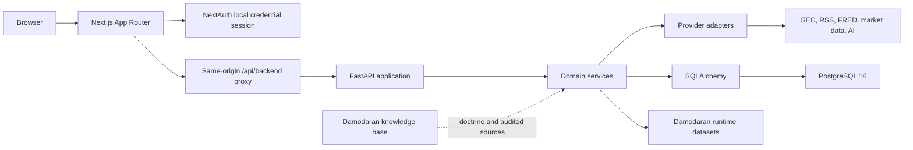
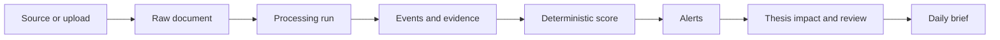
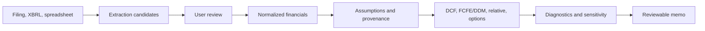

# Architecture

**Audited:** 2026-08-08

**Deployment boundary:** local Docker Compose only

## System Shape



Docker services are `frontend`, `backend`, `postgres`, and optional `pgadmin`.
The default stack runs a standalone production-built Next.js server and a
single-process FastAPI server. Hot reload and bind-mounted source trees are
isolated in `docker-compose.dev.yml`; pgAdmin is behind the `admin` profile.
Compose healthchecks gate dependent startup and local JSON logs are bounded.
The frontend uses `API_BASE_URL` (with a fallback to `NEXT_PUBLIC_API_BASE_URL`) for server-rendered API requests. For browser-initiated API requests, the frontend uses the same-origin Next.js proxy route (`/api/backend`). The backend is still reachable on port 8000 for local
operations and tests; signed internal identity protects owned routes.

## Ownership Boundaries

| Layer | Owns | Must not own |
|---|---|---|
| `frontend/app` | Routes, composition, server/client boundaries | Finance formulas or provider secrets |
| `frontend/components` | Reusable interaction and data-state UI | Direct database or external-provider access |
| `frontend/lib` | API clients, types, validation, formatting | Hidden business decisions |
| `backend/app/api/routers` | HTTP validation, auth dependencies, response envelopes | Multi-step domain logic |
| `backend/app/services` | Business workflows, deterministic calculations, persistence orchestration | UI formatting |
| `backend/app/providers` | External-source contracts and provider-specific behavior | Cross-domain application policy |
| `backend/app/models` | Persistence structure and relationships | API response shape |
| `backend/app/schemas` | Typed request/response contracts | Database lifecycle logic |
| `backend/alembic/versions` | Ordered schema evolution | Runtime data repair without explicit migration logic |
| `damodaran_knowledge_base_v1` | Valuation doctrine, source catalog, immutable raw corpus | Live application state |

## Request and Identity Flow

1. The user signs in through the local NextAuth credential page.
2. Server-rendered frontend code uses the server API helper.
3. Browser code calls `/api/backend/*` on the frontend origin.
4. The proxy validates the session and forwards a signed internal identity.
5. FastAPI dependencies resolve the user and enforce owned-resource access.
6. Routers return the shared response envelope.

Only explicit health/readiness routes are public. The canonical health route is `/api/health`. The route `/health` is maintained only for legacy compatibility. This boundary is designed for
localhost, not internet exposure.

## Response and Trust Contract

New endpoints use:

```json
{
  "data": {},
  "meta": {
    "status": "success",
    "source": "internal",
    "last_updated": "2026-08-08T00:00:00Z",
    "is_stale": false,
    "is_mock": false,
    "warnings": [],
    "confidence": "medium"
  },
  "errors": []
}
```

Important facts and calculations should carry source, timestamp/as-of date,
freshness, claim type, confidence, and limitations. The frontend must preserve
those states rather than flattening the response into an unexplained number.

The standard frontend pattern for rendering these states is the `DataStateNotices` component in `frontend/components/ui/data-states.tsx`. All page and panel components fetching data should pass the response `meta` block to `DataStateNotices` to ensure consistent rendering of stale data warnings, mock data disclaimers, and provider errors. All page-level fetch promises should include a `.catch()` block that yields a `meta.is_mock` or `meta.status = "error"` envelope, allowing partial renders via `DataStateNotices` instead of crashing the Next.js server component.

## Core Workflows

### Document to intelligence



Every external action should create a processing run. Imported text and HTML are
untrusted. Exact locators are stored where available; unsupported historical
records must retain explicit fallback states.

### Financials to valuation



Promotion is a trust boundary. Unreviewed candidates and AI suggestions must not
silently become valuation facts.

### Damodaran data lifecycle

Runtime workbooks are mirrored under `data/damodaran/raw`. Implemented importers
validate exact contracts, hash source bytes, preserve changed versions, reactivate
known hashes, link typed rows to a dataset version, and expose only the active
version. Generic parsing is inventory, not application support.

The separate knowledge base preserves raw doctrine and source extraction under
its own `AGENTS.md` and audit process.

## Provider Architecture

Provider interfaces isolate market data, fundamentals, company lookup, filings,
macro data, and AI. Provider configuration and health must be explicit. Missing
keys produce not-configured states, not fake fallback values. Unofficial Yahoo
access is personal-use only and must remain labeled as such.

## Current Architectural Debt

1. Router prefixes and legacy aliases are not fully uniform.
2. The frontend still mixes server-rendered and client data access patterns in
   ways that require route-by-route review.
3. Many advanced models exist before their user workflows are equally mature.
4. Provider coverage and health are thinner than the valuation/domain layer.
5. Historical evidence precision is uneven.
6. One-active Damodaran version is enforced by the serial service path rather
   than a partial database uniqueness constraint.
7. Public deployment architecture is intentionally absent.

## Architecture Change Rules

- Prefer existing service and provider boundaries.
- Keep routers thin and calculations deterministic.
- Add migrations; never rewrite or drop local data casually.
- Preserve tenant ownership on all user-created resources.
- Keep external content untrusted and fetched through bounded provider code.
- Do not add a model unless a real workflow consumes it.
- Keep current architecture here; put implementation history in `archive/`.

The previous cumulative architecture document is preserved at
[`archive/assessments/02-architecture.md`](archive/assessments/02-architecture.md).
