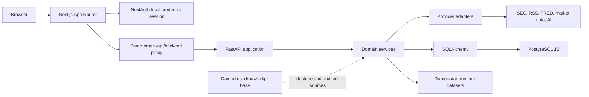
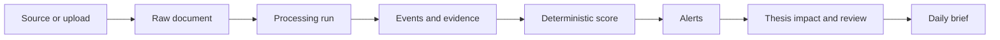
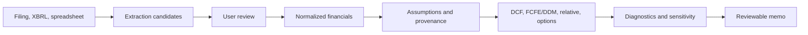
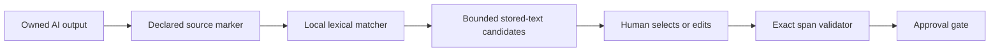
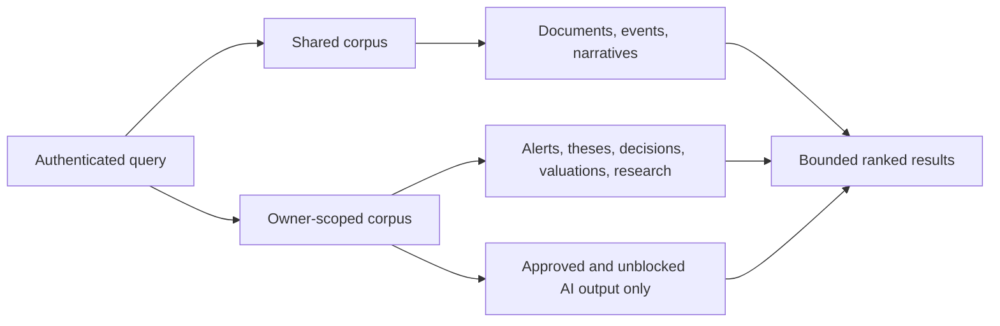
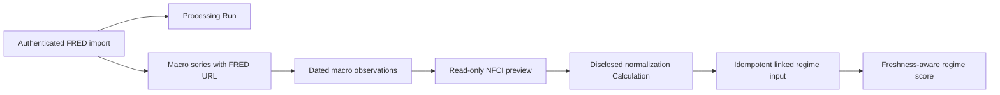

# Architecture

**Updated:** 2026-10-11 (module ownership). Product validation scope is in [Current State](00-current-state.md).

**Deployment boundary:** local Docker Compose only

Domain schemas now own every legacy HTTP contract; the facade only re-exports
identical classes and aliases. Server actions similarly have eight domain owners
behind the original frontend import path. Peer calculations/receipts, autofill
provenance and workbook parsing are separate from persistence workflows. Data
Health, peer review and draft review separate request handling from presentation;
company/draft identity changes invalidate the old UI request scope. See the
[code map](code-map.md) for owners and compatibility/drift guards. No service or
database split is introduced.

## System Shape



Docker services are `frontend`, `backend`, `postgres`, optional `pgadmin`, and
the opt-in Daily Brief `scheduler` and valuation `source_scheduler` workers.
The default stack runs a standalone production-built Next.js server and a
single-process FastAPI server. Hot reload and bind-mounted source trees are
isolated in `docker-compose.dev.yml`; pgAdmin is behind the `admin` profile.
Compose healthchecks gate dependent startup and local JSON logs are bounded.
Only the backend's startup command runs migrations. Both workers wait for backend
readiness and then start their Python worker directly; they cannot race its DDL.
pgAdmin has a 512 MiB limit and no automatic restart, so opting into administration
does not make it a permanent background service after a Docker restart.

The backend Dockerfile has a shared application stage, an explicit test target
with pytest/fixtures, and a default runtime target without them. Test and E2E
Compose select the test target. Requirements are separated without changing the
pinned runtime versions. The backend build context allowlists maintained backend
code, scripts and build configuration, excluding data/corpus, local environments,
secrets and generated caches. Development watches backend/app only and keeps
runtime data read-only; its frontend receives 2 GiB for the configured 1.5 GiB heap.
These source changes require recreation to affect existing normal containers.

An independent tools target adds Git and shasum for repository/recovery checks.
docker-compose.tools.yml runs it with no network, a read-only source tree and an
executable temporary filesystem for the recovery tests' fake Docker CLI. It has
no Docker socket, normal database, published port or loaded environment file.
These administrative/test utilities are absent from the default runtime image.

The frontend uses `API_BASE_URL` (with a fallback to `NEXT_PUBLIC_API_BASE_URL`) for server-rendered API requests. For browser-initiated API requests, the frontend uses the same-origin Next.js proxy route (`/api/backend`). The backend is still reachable on port 8000 for local
operations and tests; signed internal identity protects owned routes. Compose
publishes host ports on 127.0.0.1 in both normal and disposable-test definitions.
Existing containers retain their prior bindings until recreated. Inspect actual
runtime ports; this configuration is not public-deployment hardening.

Use the [code map](code-map.md) for actual entry-point files and tests. Do not
reconstruct a proposed folder tree from old agent instructions.

## Ownership Boundaries

| Layer | Owns | Must not own |
|---|---|---|
| `frontend/app` | Routes, composition, server/client boundaries | Finance formulas or provider secrets |
| `frontend/components` | Reusable interaction and data-state UI | Direct database or external-provider access |
| `frontend/lib/api/<domain>.ts` | Domain contracts and endpoint helpers; type-only cross-domain references | Fetch/environment handling or imports through the compatibility facade |
| `frontend/lib/api/transport.ts` | Browser HTTP, multipart, binary, response parsing | Domain endpoints or server session handling |
| `frontend/lib/api/contract.ts` | Shared envelope and error identity | Environment reads, framework dependencies, fetching |
| `frontend/lib/server-api.ts` | Authenticated server requests and runtime session boundary | Browser transport imports |
| `frontend/lib` | Request isolation, validation and formatting helpers | Hidden business decisions |
| `backend/app/api/routers` | HTTP validation, auth dependencies, response envelopes | Multi-step domain logic |
| `backend/app/services` | Business workflows, deterministic calculations, persistence orchestration | UI formatting |
| `backend/app/providers` | External-source contracts and provider-specific behavior | Cross-domain application policy |
| `backend/app/models` | Persistence structure and relationships | API response shape |
| `backend/app/schemas` | Shared envelope plus extracted valuation, portfolio, research, evaluation and macro contracts; saved valuation response assembly | Database lifecycle logic or HTTP dependencies in pure contracts |
| `backend/app/api/schemas.py` | Remaining legacy contracts and extracted-contract compatibility exports | New valuation/portfolio implementation or duplicate class names |
| `backend/alembic/versions` | Ordered schema evolution | Runtime data repair without explicit migration logic |
| `damodaran_knowledge_base_v1` | Valuation doctrine, source catalog, immutable raw corpus | Live application state |

## Request and Identity Flow

1. The user signs in through the local NextAuth credential page.
2. Server-rendered frontend code uses the server API helper.
3. Browser code calls `/api/backend/*` on the frontend origin.
4. The proxy validates the session and forwards a signed internal identity.
5. FastAPI dependencies resolve the user and enforce owned-resource access.
6. Routers return the shared response envelope.

Only explicit health/readiness routes are public. The canonical health route is `/api/health`. The route `/health` is maintained only for legacy compatibility. This boundary is designed for
localhost, not internet exposure.

## Response and Trust Contract

New endpoints use:

```json
{
  "data": {},
  "meta": {
    "status": "success",
    "source": "internal",
    "last_updated": "2026-08-08T00:00:00Z",
    "is_stale": false,
    "is_mock": false,
    "warnings": [],
    "confidence": "medium"
  },
  "errors": []
}
```

Important facts and calculations should carry source, timestamp/as-of date,
freshness, claim type, confidence, and limitations. The frontend must preserve
those states rather than flattening the response into an unexplained number.

Use DataStateNotices in frontend/components/ui/data-states.tsx to preserve
response metadata. Metadata-aware helpers return error envelopes for unavailable
requests. A failed request is not evidence of mock or cached data; never mark
is_mock merely because transport failed. Data-only helpers throw and require
an explicit error boundary or catch appropriate to the caller.

## Contract and compatibility boundaries

Frontend lib/api.ts contains exports only. New API work goes into the relevant
lib/api domain module. Transport is shared by those browser helpers; server-api
imports only the common contract, preserving its own request-scoped identity and
runtime configuration. JSON mutations share one implementation. GET metadata,
data-only reads, binary downloads, multipart writes, and the legacy default
envelope client retain their distinct response/error contracts.

Backend valuation_inputs and valuation_outputs are independently importable
without HTTP, services, or ORM. Saved valuation response assembly lives in
app/schemas/valuation.py and retains context-aware, detached pricing reads.
Valuation services import narrow contracts directly; old HTTP imports still
resolve to the same classes. StoredFinancialMetricRead and the legacy chart
FinancialMetricRead are distinct names instead of overwritten definitions.
Their response fields are unchanged; OpenAPI component names now distinguish
the stored and chart schemas explicitly.

`app/schemas/common.py` owns ApiResponse, ApiMeta and ApiErrorDetail without HTTP,
services or ORM imports. Error handling and envelope-only routes depend on this
small module, not the legacy schema collection and its saved-valuation service
graph. The facade re-exports the same classes, including generic specializations;
contract identity, isolated imports and OpenAPI comparisons guard compatibility.

Portfolio request/response contracts now live in app/schemas/portfolio.py with no
HTTP, service or ORM imports. The portfolio router imports them directly; legacy
imports re-export the same classes. Whole-OpenAPI comparison protects the
extraction independently of intentional validation changes in other domains.

Portfolio valuation scopes private DCF/thesis/alert context to the persisted
portfolio owner even when an internal caller omits user_id; a different explicit
owner is rejected. Event-driven valuation alerts use the selected model's owner,
validate company/change-log relationships and link only that owner's portfolios.
These protections do not recalculate or relabel historical records.

## Core Workflows

### Read-loading and page composition

Company, portfolio, source and processing-run rows do not automatically load
their entire related graph. High-cardinality collections and backreferences use
lazy loading; a workflow explicitly eager-loads relationships it serializes or
uses after closing its session. Company exposure tags remain eager because the
company response includes them. Query-budget tests cover the common read paths.

Portfolio valuation selects the latest eligible price per security with a SQL
window, rather than materializing its whole price history. Historical risk still
loads the bounded series it needs. Provider health selects the latest run per
normalized status/provider and aggregates counts in SQL, retaining the last
success and consecutive-failure count without loading all historical run objects.
No cross-user response cache or stale-data substitution is introduced.

The portfolio detail route first resolves the owned portfolio, then streams only
the selected server view: Overview, Performance & risk, Activity, or Data & setup.
Each view owns its requests and metadata handling. A legacy URL with only period
dates selects Performance; new period forms retain that tab explicitly. The
default Overview does not execute risk, attribution, readiness or setup queries.
Dashboard uses its single consolidated read; company editing mounts only the
selected record's form. Saved valuation refresh resets versioned form inputs
without remounting the workspace's save confirmation.

Risk comparison exposes each latest price date and age. Prices older than five
calendar days make the result partial and withhold the current DCF price gap;
historical risk can still be shown with the stale-price warning. This is not
historical transaction replay or a guarantee of live pricing.

The saved DCF relative-valuation workflow uses read-only
`GET /api/valuation/relative/assumptions/{assumption_id}/inputs` and
`POST /api/valuation/relative/assumptions/{assumption_id}/run`. Both resolve the
assumption through its owned model. The adapter owns the numeric mapping and
input provenance; the browser submits benchmark selection, explicit input-basis
confirmation, and the preview SHA-256, never replacement company financials.
The run rereads the saved inputs and rejects a changed hash before invoking the
existing relative engine. No extra assumption record or DCF run is created.
The direct custom-financial relative route retains its prior contract.

DCF implied pricing is separate from benchmark relative valuation. The pricing
service maps final DCF values and explicit saved denominators. Response schemas
provide the owned assumption context to a detached read-time reconciliation;
contextless reads suppress legacy ratios. The adapter replaces only structured
pricing diagnostics and returns formula/source/timestamp metadata, without
writing historical records or rerunning their DCF or quality score. Scenario
responses receive their transient scenario assumptions, not a different Base set.

Scenario generation dispatches through the owned model's engine and rejects stale
or invalid saved input sets. It remains a non-persisting calculation. The scenario
UI mounts on demand, isolates responses by model/input identity and timestamp,
and uses backend values and gaps instead of browser finance formulas. A shared
saved-output display helper gates currency, identity, diagnostics, stale state,
and finite values for the headline, supplementary, multi-method and scenario
cards. Historical scores are displayed as stored calculations, never synthesized.

### Document to intelligence



Every external action should create a processing run. Imported text and HTML are
untrusted. Exact locators are stored where available; unsupported historical
records must retain explicit fallback states.

### Financials to valuation



Promotion is a trust boundary. Unreviewed candidates and AI suggestions must not
silently become valuation facts.

The separate source-to-draft path reads annual SEC candidates as **Source Summary**
suggestions, never as promoted company facts. A newer annual basis can populate
an owned draft; an existing reviewed annual basis is not mixed with differently
scaled SEC amounts. Sources retain candidate IDs, exact locators, dates, units and
review requirements. FRED DGS10 supplies an explicitly reviewed USD rate proxy,
not an INR rate; market inputs retain the stored price's as-of date.

`valuation_source_refresh` owns a durable ProcessingRun queue. HTTP enqueues and
returns immediately; the separate worker fetches FRED/SEC/prices, records child
runs, then refreshes owned drafts while preserving edits. Weekday 07:00 New York
execution is opt-in via local settings, once per local day, DST-aware and guarded
by a PostgreSQL advisory lock. Failures remain visible; interrupted jobs need an
explicit retry, and missed dates are not replayed. No external AI, source approval
or saved-model writes occur. Draft mutations lock/reload the persisted row before
their optimistic-version check. This does not add a general-purpose job platform.

### AI claim to exact evidence

The Daily Brief research inbox has a separate private-source workflow:
`brief_sources` routes -> intake/extraction service -> owner-scoped source table
-> explicit disclosed AI scan -> structured findings and exact quote validation
-> links to existing valuation-draft controls. No draft values, holdings or thesis
notes are transmitted. Provider/model/input hash, source/page spans, failures and
review state remain inspectable. Invalid output is blocked, never replaced with
Mock Data. The source list excludes full text/PDF bytes; detail and binary routes
require ownership and use private/no-store responses. Normal reads do not scan.
The proxy permits 45 seconds only for explicit source scans; ordinary requests
retain their short timeout. Source parsing, AI orchestration and presentation
have separate owners. The inbox is not yet part of scheduled brief snapshots.

Private-source search filters stored title/text, company, format, scan state and
active/archived state before a bounded ID cursor page. Collections default to
active sources. Owner-only detail and PDF links still resolve archived evidence.
The lifecycle service owns version-checked archive/restore writes independently
of source content and AI review. Live scans block organization changes; expired
scans may be abandoned after two minutes. Scan publication/failure compares the
claimed start timestamp and lifecycle version, so late attempts cannot overwrite
a newer success or revive an archived/restored record. Failed provider attempts
remain in AI execution records, without guessing the latest output's identity.

`brief_source_triage` is a separate read-only comparison service. An authenticated
company-scoped GET examines at most the newest 50 active private sources, with
three bounded evidence queries, plus one latest-review query, and no original-body loads. It reconstructs constrained
findings from the linked output and exact-span receipts, excluding failed,
blocked, rejected, revision-required or mismatched output. Groups reference the
shared source findings instead of duplicating evidence for every field. Draft
links are rebuilt from the field catalog, not trusted from stored AI/UI strings.
Opposing increase/decrease suggestions across distinct content are review flags,
not verified contradictions. Exact text hashes prevent copied records from
becoming cross-content corroboration; Mock Data is opt-in and never compared
against non-mock evidence. Counts, exclusions, source dates, provenance and the
50-source window remain visible. The frontend owns filters/display only, clears
responses on scope changes or failures, and offers separate source/draft links.
This read model has no provider, approval, resolution or valuation-write path.
Following a draft link enters the existing draft workflow, which can initialize
a review-required draft if absent. No comparison suggestion is applied there.

`brief_comparison_reviews` owns the separate append-only analyst-decision workflow.
It recomputes a canonical company comparison hash, checks the displayed evidence
and expected scoped review version, then stores the selected group's evidence
and rationale. A user-row lock and unique scoped version prevent competing review
writes from silently replacing each other. History/detail are owner-scoped and
report whether the stored evidence basis still matches. They do not approve AI,
resolve semantic conflicts or update financial values. Changed sources can make
a receipt historical immediately after saving; receipts are not permanent truth.

Security boundary helpers have separate owners: frontend `request-security.ts`
checks trusted host/same-origin mutations, forwards only allowed headers and
bounds bodies; `local-login.ts` throttles attempts and compares hashed credentials.
Backend `request_limits.py` bounds bodies before parsing; `rate_limits.py` applies
per-path defaults without relying on lazy router traversal. Public-source downloads
use `providers/safe_http.py` for validated pinned DNS, TLS and byte limits.
Normal backend/workers are non-root; web/workers drop capabilities, prevent
privilege escalation and bound processes/memory. These are local hardening,
not a public-deployment authorization or comprehensive sandbox.

Company/portfolio research cards use one bounded SQL query over selected company
identities and latest stored annual Item 1 excerpts. Full document graphs are not
loaded. Missing business text stays unavailable. Comps navigation exposes the
existing owner-scoped peer workspace; it does not create a second calculation or
an unsupported automatic peer-data feed.



The matcher is deterministic and local. It returns exact quotes and offsets,
not trusted citations. It never calls an external model, never mutates the AI
output, and cannot bypass validation or human review. Unsupported source types,
missing stored text, undeclared markers, and low-overlap candidates remain
explicit states.

### Unified stored-research search



`backend/app/services/evidence_search.py` owns search and ranking. PostgreSQL
uses full-text search; SQLite tests use bounded `ILIKE` matching. Narrative
records retain their existing shared scope and are labeled as interpretations.
Research sessions, user messages, and AI output are private and filtered through
the authenticated user. Assistant message bodies are not independently indexed;
their linked output becomes searchable only after the existing human-review and
blocking gates pass. Company filters exclude private research sessions because
those records have no company relationship rather than guessing one.

### FRED observation to Market Regime input



Import owns external network access and audit persistence. Preview and apply use
stored records only. The apply action never fetches FRED, and each automated
input retains the exact `macro_observation` record ID. Manual provider
declarations without a stored record remain Source Summaries.

### Damodaran data lifecycle

Runtime workbooks are mirrored under `data/damodaran/raw`. Implemented importers
validate exact contracts, hash source bytes, preserve changed versions, reactivate
known hashes, link typed rows to a dataset version, and expose only the active
version. Generic parsing is inventory, not application support.

The separate knowledge base preserves raw doctrine and source extraction under
its own `AGENTS.md` and audit process.

## Provider Architecture

Provider interfaces isolate market data, fundamentals, company lookup, filings,
macro data, and AI. Provider configuration and health must be explicit. Missing
keys produce not-configured states, not fake fallback values. Unofficial Yahoo
access is personal-use only and must remain labeled as such.

Market quote-plus-history and quote-only routes share the audited workflow in
app/services/market_data/ingestion.py. It records the attempt before provider
configuration/fetch, flushes prices before same-date duplicate checks, and commits
price/history writes with caller-owned price-divergence alerts. A downstream
failure rolls data back and retains a failed Processing Run. The factory returns
the explicitly selected adapter, never an implicit fallback provider.

Gemini uses one transport for summaries, chat and structured generation. The key
is sent in a header, never a URL; GEMINI_MODEL selects a validated model name.
Incomplete responses are rejected, internal thought parts excluded, and failures
sanitized. The explicit connectivity probe sends only a fixed non-private prompt
and records its model/input hash in a Processing Run. Provider health matches
the configured model to probe evidence; a key alone is not working-provider proof.
This says nothing about research quality, citation correctness or future quotas.

## Current Architectural Debt

The [single limitation ledger](agent_capabilities_and_limitations.md) tracks
remaining architecture and product gaps. Important follow-ups are the remaining
unextracted HTTP schema collection, large server actions and UI/service owners,
split market-provider placement, source-string-heavy frontend tests, manual
frontend/backend type synchronization, and legacy route aliases. Do not hide
these by moving everything into a new catch-all directory.

See the code map for service owners and Current State for dated validation and
separately verified runtime rollout. Historical saved outputs are not rewritten;
adjacent methods remain separate audit boundaries.

## Operational ownership

The runbook owns commands and the setup guide owns configuration. Source code,
database records, runtime workbook mirrors and the immutable knowledge corpus
are distinct assets. A source refactor does not require reseeding any of them.
The restore script stops backend/frontend and any running/restarting Daily Brief/source
workers before replacement; only those previously active workers are resumed after
verification and migration. Other database clients must be quiesced manually.
Never test replacement against the normal database without explicit authority.

## Architecture Change Rules

- Prefer existing service and provider boundaries.
- Keep routers thin and calculations deterministic.
- Add migrations; never rewrite or drop local data casually.
- Preserve tenant ownership on all user-created resources.
- Keep external content untrusted and fetched through bounded provider code.
- Do not add a model unless a real workflow consumes it.
- Keep current architecture here; put implementation history in `archive/`.

The previous cumulative architecture document is preserved at
[`archive/assessments/02-architecture.md`](archive/assessments/02-architecture.md).
