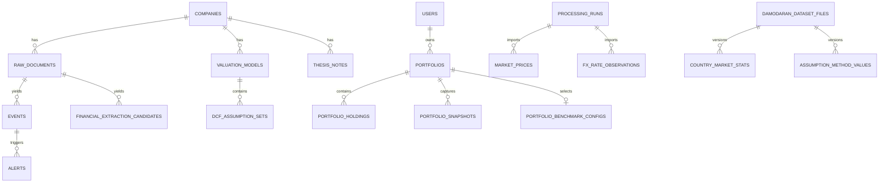

# Database Schema Map

**Source reviewed:** 2026-09-30. Runtime verification is recorded in Current State.

**Current source head:** `s1s1s1s1s1s1`. Migration adds analyst comparison receipts.
Check Current State for the normal runtime's verified revision.

This document maps ownership and relationships. SQLAlchemy models and Alembic
migrations are the field-level source of truth. Do not duplicate every column
here; that caused the previous schema document to drift.

## Schema Rules

- All models import `Base` from `app.db.base`.
- New tables and columns require additive Alembic migrations.
- User-owned records carry `user_id` directly or inherit ownership through a
  parent relation.
- External-source facts preserve provenance and review state where applicable.
- Raw documents and historical dataset versions are not silently overwritten.
- API schemas are separate from ORM models.

## Domain Groups

| Domain | Primary tables | Model files |
|---|---|---|
| Identity and companies | `users`, `companies`, `company_setup_workflows`, `exposure_tags`, `company_exposure_tags` | `user.py`, `company.py`, `company_setup.py` |
| Sources and documents | `sources`, `raw_documents`, `document_assets`, `processing_runs`, `filing_sections`, `filing_section_diffs` | `source.py`, `raw_document.py`, `document_asset.py`, `processing_run.py`, `sec_parsing.py` |
| Financial facts | `financial_statement_periods`, `financial_metrics`, `financial_extraction_candidates`, `normalized_financial_snapshots`, `normalized_financial_metrics`, `source_fact_revisions` | `financial.py`, `source_fact_revision.py` |
| Intelligence | `events`, `event_corroborations`, `event_contradictions`, `event_evidence_references`, `alerts`, `alert_portfolio_impacts`, `daily_briefs`, `scoring_configs` | `event.py`, `event_evidence_reference.py`, `alert.py`, `daily_brief.py`, `scoring_config.py` |
| Thesis and decisions | `thesis_notes`, `thesis_assumptions`, `event_thesis_impacts`, `thesis_changes`, `evidence_ledger`, `decision_logs`, `variant_perception` | `thesis_note.py`, `evidence.py`, `decision_journal.py`, `variant_perception.py` |
| Portfolio | `portfolios`, `portfolio_holdings`, `portfolio_transactions`, `portfolio_cash_balances`, `portfolio_snapshots`, `portfolio_benchmark_configs` | `portfolio.py` |
| Market and macro | `market_prices`, `company_market_data`, `market_source_capabilities`, `fx_rate_observations`, `macro_series`, `macro_observations`, `country_market_context`, `market_regime_inputs`, `market_regime_scores` | `market_price.py`, `market_source.py`, `fx_rate.py`, `macro.py`, `country_market_data.py`, `market_regime_input.py`, `market_regime.py` |
| Macro sensitivity | `sector_macro_sensitivity_benchmarks`, `company_macro_inputs`, `company_macro_sensitivity_results`, `company_macro_segment_exposures` | `macro_sensitivity.py` |
| Industry mapping | `company_industry_mixes`, `company_industry_allocations` | `company_industry.py` |
| Valuation | `valuation_models`, `valuation_setup_drafts`, `dcf_assumption_sets`, `dcf_projection_years`, `dcf_outputs`, `dcf_sensitivity_tables`, `dcf_decision_logs`, `valuation_assumption_change_logs`, `peer_valuation_sets`, `peer_valuation_set_revisions`, `peer_valuation_members`, `peer_valuation_revision_members`, `peer_valuation_target_profiles`, `peer_valuation_revision_target_profiles` | `dcf.py`, `peer_valuation.py` |
| Valuation methodology | `assumption_method_values`, `valuation_assumption_provenance`, `valuation_accounting_adjustments`, `company_rd_history` | `assumption_methodology.py`, `accounting.py`; method rows may link to exact Damodaran dataset versions |
| Damodaran runtime data | `damodaran_dataset_files`, industry benchmark tables, `regression_model_coefficients`, `country_market_stats` | `damodaran.py`, `damodaran_fundamentals.py` |
| Real options | `industry_volatility_benchmarks`, `real_option_assumptions`, `real_option_results`, `option_eligibility_tests` | `real_options.py` |
| Research and AI | `research_sessions`, `research_messages`, `ai_outputs`, `brief_sources`, `brief_comparison_reviews` | `research.py`, `ai.py`, `brief_source.py`, `brief_review.py` |
| Extraction evaluations | `evaluation_runs`, `financial_extraction_evals` | `evaluation.py`; new runs belong to a user and retain source/reference hashes plus a bounded comparison report |
| Narratives and social | `narrative_clusters`, `narrative_claims`, `narrative_mentions`, `social_posts`, `sentiment_scores` | `narrative.py`, `social.py` |
| Disabled legacy OAuth storage | `oauth_tokens` | `oauth_token.py`; writes disabled, existing records preserved |

## Important Relationships

Additional persisted workflow tables include `daily_brief_schedules`
([model](../backend/app/models/daily_brief_schedule.py)) and
`financial_reconciliation_records` ([financial models](../backend/app/models/financial.py)).
Real-options tables describe schema availability; the current owned saved-basis
panel computes without persisting option inputs or results.

The diagram is intentionally conceptual. Verify exact foreign keys in model and
migration files before changing cascades or ownership.

## Lifecycle Boundaries

### Financial facts

Raw evidence becomes an extraction candidate. A user review can promote it into
financial periods/metrics and normalized snapshots. Point-in-time revisions are
stored for reviewed financial facts. Unreviewed candidates are not trusted facts.

### Extraction evaluations

Migration `p7p7p7p7p7p7` adds nullable `user_id` and `report_json` to
`evaluation_runs`, with a user foreign key and index. Historical unowned records
remain intact and are excluded from owner-scoped API reads; ownership is not
guessed. New executed runs persist the report and metric scores atomically.
Evaluation reads stored text without creating/promoting candidates or changing
the document. Reference rows remain reviewer assertions, not certified facts.

### Valuation drafts

Setup drafts are durable and versioned for optimistic concurrency. Assumption
provenance, change logs, projections, outputs, sensitivity tables, and decision
logs are separate records so calculations remain inspectable. Each persisted
DCF assumption version also retains its cash-flow currency, discount-rate
currency, and required override rationale when those currencies differ.

### Reviewed peer valuation sets

`peer_valuation_sets` is owner-scoped and company-scoped. It retains structured
JSON snapshots for compatibility and audit comparison. `peer_valuation_members`
is the normalized current representation, ordered by ordinal and unique by
identifier within a set. Each row can retain the optional company link,
inclusion state, per-method multiples, source metadata, country, currency,
fiscal period, accounting standard, market cap, growth, margin, and notes. New
writes replace the current rows atomically and expose JSON/relational consistency.
The parent row also retains aggregation method, active state, review status,
review timestamp, reviewer, the accepted diagnostic SHA-256, warning-code JSON,
and diagnostic as-of date. Only active reviewed sets with a current diagnostic
receipt may drive relative valuation. Editing the members or metadata resets
review and clears the receipt.

Imported parent rows also retain `import_sha256`, the hash of the exact UTF-8
CSV request content that passed preview. A unique owner/company/hash constraint
makes an uncertain or concurrent exact retry return the existing record instead
of creating another Draft. The field is nullable so manual sets and legacy rows
remain valid. Migration `n5n5n5n5n5n5` does not invent receipts for preexisting
imports because their original file bytes cannot be proven from stored rows.

`peer_valuation_set_revisions` stores immutable, owner-scoped snapshots for each
version and action. A unique peer-set/version constraint prevents revision
replacement. Existing rows receive a version-1 migration snapshot. Mutations
must match the current version, and restore clears review before the set becomes
active again. Review revisions retain the same diagnostic receipt fields as the
current set. Migration `o6o6o6o6o6o6` adds these nullable receipt fields without
inventing acknowledgements for earlier reviews. `peer_valuation_revision_members` stores the normalized member
facts for each immutable revision. Migration `l3l3l3l3l3l3` safely backfills
both normalized tables from existing JSON, including legacy string members.

`peer_valuation_target_profiles` stores the optional normalized current target-
company comparability facts, source identity, and source date one-to-one with a
peer set. `peer_valuation_revision_target_profiles` preserves the same evidence
one-to-one with each immutable revision. The parent JSON fields remain a
compatibility and consistency check. Migration `m4m4m4m4m4m4` adds empty JSON
defaults for legacy parents but deliberately creates no target facts for them.

### Damodaran datasets

`damodaran_dataset_files` stores source hash, source date, confidence, active
state, typed/generic import kind, and row counts. Typed benchmark rows link to a
dataset version. Active readers must join through the active version. Valuation
method rows now use the same dataset link, so rate, beta, capital-structure,
WACC, and tax defaults cannot outlive their approved source version silently.

### Owned resources

Migration `q8q8q8q8q8q8` adds immutable owner-private brief sources, separate from
the shared raw-document catalog. Text and original PDF bytes are deferred fields;
collection responses exclude them. Identity hashes deduplicate source/company/
owner/date/page-selection retries. Each source retains extraction spans, hashes,
scan status and a linked owned AI output; all historical attempts remain audited.
Original PDFs live in `brief_sources.pdf_bytes`, not `document_assets`. PostgreSQL
backups include both tables; the legacy asset-specific manifest summary counts
only `document_assets`. Private source content requires its owner's detail route.

Migration `r9r9r9r9r9r9` adds nullable `archived_at` and `lifecycle_version`
(default 1). Existing evidence stays active and unchanged. Archive/restore writes
lock the owned source and require its viewed version. Archiving is organization,
not deletion or human review; original URLs, text, PDF bytes, hashes and completed
AI findings remain readable. Duplicate intake never restores an archived source.
There is no permanent-delete endpoint or full lifecycle history table.

Migration `s1s1s1s1s1s1` adds `brief_comparison_reviews` only. Each append-only
receipt stores owner/company/field/Mock Data scope, sequential review version,
comparison hash, analyst rationale/disposition and the exact selected evidence
snapshot. A user-row lock and unique scoped version serialize review writes.
Evidence changes produce stale status on reads; old receipts remain readable.
The API does not edit/delete receipts, approve AI or write valuation assumptions.

Companies and sources are shared authenticated catalogs, not user-owned tables.
Private portfolios, valuation models, research sessions and related records must
resolve through their owner, directly or through a parent. Authentication alone
is not tenant isolation. Check each route's ownership dependency before changing
access; a numeric identifier alone is never authorization.

### Macro and Market Regime provenance

FRED-backed `macro_series` rows retain `provider_name` and the official
`source_url`. Automated `market_regime_inputs` retain a polymorphic
`source_record_type` and `source_record_id`; the NFCI adapter uses
`macro_observation`. A unique constraint prevents applying the same provider
observation to the same regime module more than once. Manual inputs keep these
fields null.

### Portfolio performance

Generated snapshots preserve dated holding/cash values, base currency,
completeness, missing-price and missing-FX blockers, and source provenance.
Historical FX observations and the portfolio's explicit benchmark configuration
are separate owned inputs. Performance, attribution, and opportunity cost are
calculated read models rather than silently persisted estimates.

## Migration Procedure

Use the [runbook](08-execution-runbook.md) for migration inspection, authorized
upgrades and source-mounted isolated tests. Existing production containers can
contain older code; do not use their test results to certify edited source.

Stop if the migration chain has multiple unexpected heads, references a missing
revision, drops data, or rewrites existing values without an explicit approved
backfill plan.

The prior field-by-field snapshot is archived at
[`archive/assessments/03-database-schema.md`](archive/assessments/03-database-schema.md).
