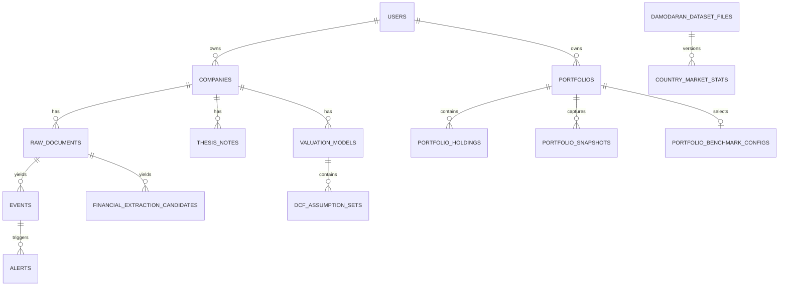

# Database Schema Map

**Audited:** 2026-08-09

**Current head:** `cc4cc4cc4cc4`

This document maps ownership and relationships. SQLAlchemy models and Alembic
migrations are the field-level source of truth. Do not duplicate every column
here; that caused the previous schema document to drift.

## Schema Rules

- All models import `Base` from `app.db.base`.
- New tables and columns require additive Alembic migrations.
- User-owned records carry `user_id` directly or inherit ownership through a
  parent relation.
- External-source facts preserve provenance and review state where applicable.
- Raw documents and historical dataset versions are not silently overwritten.
- API schemas are separate from ORM models.

## Domain Groups

| Domain | Primary tables | Model files |
|---|---|---|
| Identity and companies | `users`, `companies`, `company_setup_workflows`, `exposure_tags`, `company_exposure_tags` | `user.py`, `company.py`, `company_setup.py` |
| Sources and documents | `sources`, `raw_documents`, `document_assets`, `processing_runs`, `filing_sections`, `filing_section_diffs` | `source.py`, `raw_document.py`, `document_asset.py`, `processing_run.py`, `sec_parsing.py` |
| Financial facts | `financial_statement_periods`, `financial_metrics`, `financial_extraction_candidates`, `normalized_financial_snapshots`, `normalized_financial_metrics`, `source_fact_revisions` | `financial.py`, `source_fact_revision.py` |
| Intelligence | `events`, `event_corroborations`, `event_contradictions`, `event_evidence_references`, `alerts`, `alert_portfolio_impacts`, `daily_briefs`, `scoring_configs` | `event.py`, `event_evidence_reference.py`, `alert.py`, `daily_brief.py`, `scoring_config.py` |
| Thesis and decisions | `thesis_notes`, `thesis_assumptions`, `event_thesis_impacts`, `thesis_changes`, `evidence_ledger`, `decision_logs`, `variant_perception` | `thesis_note.py`, `evidence.py`, `decision_journal.py`, `variant_perception.py` |
| Portfolio | `portfolios`, `portfolio_holdings`, `portfolio_transactions`, `portfolio_cash_balances`, `portfolio_snapshots`, `portfolio_benchmark_configs` | `portfolio.py` |
| Market and macro | `market_prices`, `company_market_data`, `market_source_capabilities`, `fx_rate_observations`, `macro_series`, `macro_observations`, `country_market_context`, `market_regime_inputs`, `market_regime_scores` | `market_price.py`, `market_source.py`, `fx_rate.py`, `macro.py`, `country_market_data.py`, `market_regime_input.py`, `market_regime.py` |
| Macro sensitivity | `sector_macro_sensitivity_benchmarks`, `company_macro_inputs`, `company_macro_sensitivity_results`, `company_macro_segment_exposures` | `macro_sensitivity.py` |
| Industry mapping | `company_industry_mixes`, `company_industry_allocations` | `company_industry.py` |
| Valuation | `valuation_models`, `valuation_setup_drafts`, `dcf_assumption_sets`, `dcf_projection_years`, `dcf_outputs`, `dcf_sensitivity_tables`, `dcf_decision_logs`, `valuation_assumption_change_logs` | `dcf.py` |
| Valuation methodology | `assumption_method_values`, `valuation_assumption_provenance`, `valuation_accounting_adjustments`, `company_rd_history` | `assumption_methodology.py`, `accounting.py` |
| Damodaran runtime data | `damodaran_dataset_files`, industry benchmark tables, `regression_model_coefficients`, `country_market_stats` | `damodaran.py`, `damodaran_fundamentals.py` |
| Real options | `industry_volatility_benchmarks`, `real_option_assumptions`, `real_option_results`, `option_eligibility_tests` | `real_options.py` |
| Research and AI | `research_sessions`, `research_messages`, `ai_outputs` | `research.py`, `ai.py` |
| Narratives and social | `narrative_clusters`, `narrative_claims`, `narrative_mentions`, `social_posts`, `sentiment_scores` | `narrative.py`, `social.py` |
| OAuth foundation | `oauth_tokens` | `oauth_token.py` |

## Important Relationships



The diagram is intentionally conceptual. Verify exact foreign keys in model and
migration files before changing cascades or ownership.

## Lifecycle Boundaries

### Financial facts

Raw evidence becomes an extraction candidate. A user review can promote it into
financial periods/metrics and normalized snapshots. Point-in-time revisions are
stored for reviewed financial facts. Unreviewed candidates are not trusted facts.

### Valuation drafts

Setup drafts are durable and versioned for optimistic concurrency. Assumption
provenance, change logs, projections, outputs, sensitivity tables, and decision
logs are separate records so calculations remain inspectable.

### Damodaran datasets

`damodaran_dataset_files` stores source hash, source date, confidence, active
state, typed/generic import kind, and row counts. Typed benchmark rows link to a
dataset version. Active readers must join through the active version.

### Owned resources

Companies, portfolios, research sessions, AI output, transfers, and related
records must resolve through the authenticated owner. A numeric identifier alone
is never authorization.

### Portfolio performance

Generated snapshots preserve dated holding/cash values, base currency,
completeness, missing-price and missing-FX blockers, and source provenance.
Historical FX observations and the portfolio's explicit benchmark configuration
are separate owned inputs. Performance, attribution, and opportunity cost are
calculated read models rather than silently persisted estimates.

## Migration Procedure

```bash
docker compose exec backend alembic heads
docker compose exec backend alembic current
docker compose exec backend alembic upgrade head
docker compose exec backend pytest -q backend/tests/test_alembic.py
```

Stop if the migration chain has multiple unexpected heads, references a missing
revision, drops data, or rewrites existing values without an explicit approved
backfill plan.

The prior field-by-field snapshot is archived at
[`archive/assessments/03-database-schema.md`](archive/assessments/03-database-schema.md).
