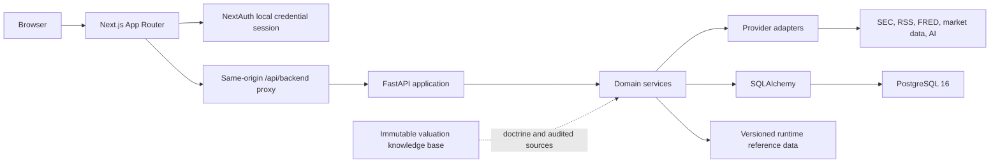

# Architecture

Local Docker Compose application. [Current State](current-state.md) owns
dated validation; [workflow details](reference/workflows.md) explain individual
pipelines; the [code map](code-map.md) links their source and tests.

## System shape

Default services are frontend, backend, and PostgreSQL. Daily Brief and
valuation-source workers use the optional automation profile; pgAdmin uses the
admin profile. The backend startup applies migrations. Workers wait for healthy
backend readiness and do not race its schema changes.

Production images run compiled Next.js and a single FastAPI process. Development
source mounts and reloaders live in `docker-compose.dev.yml`. Runtime benchmark
mounts are read-only. Published ports bind to 127.0.0.1; existing containers need
recreation to acquire configuration changes.

The backend Dockerfile separates runtime, test, and repository-tooling targets.
Unit tests use offline disposable SQLite. Browser and recovery checks use
separate PostgreSQL projects. The tools target has Git/shasum but no normal
database, Docker socket, or private settings. PostgreSQL has a separate narrow
build context under [docker/postgres](../docker/postgres/).

## Ownership boundaries

| Layer | Owns | Boundary |
|---|---|---|
| frontend/app | Routes and server/client composition | No finance formulas or provider secrets |
| frontend/components | Interaction and data-state presentation | No direct database/provider access |
| frontend/lib/api | Domain contracts and browser endpoint helpers | Shared transport; type-only cross-domain imports |
| frontend/lib/server-api.ts | Server requests and signed identity | No browser client imports |
| frontend/lib/api.ts | Compatibility exports | No new implementation |
| backend/app/api/routers | HTTP validation, authorization, serialization | Services own multi-step workflows |
| backend/app/services | Deterministic calculations and workflows | Narrow schema imports |
| backend/app/providers | External-source adapters and bounded transport | No cross-domain policy |
| backend/app/models and app/db | Persistence and relationships | No response formatting |
| backend/app/schemas | Domain contracts and saved-response assembly | Pure calculation contracts avoid HTTP/ORM |
| backend/app/api/schemas.py | Compatibility re-exports | No new contract definitions |
| backend/alembic/versions | Ordered schema evolution | Append migrations; preserve existing data |
| data | Runtime references, fixtures, review receipts | Distinct from the user's live database |
| damodaran_knowledge_base_v1 | Doctrine, catalog, immutable originals | Separate instructions and audit tooling |

The market-data factory and persistence remain under
`backend/app/services/market_data`. That existing factory is authoritative;
do not create a parallel provider registry. New frontend API work belongs in
its domain module, not the legacy facade.

## Request and identity flow

1. NextAuth validates the local credential session.
2. Server pages use the server API client; browser calls use `/api/backend/*`.
3. The proxy checks the session and same-origin writes, then signs a short-lived
   internal identity. Raw session cookies are not forwarded to FastAPI.
4. Backend dependencies resolve identity and owned parent resources.
5. Routers return the shared data/meta/errors envelope.

Companies and source catalogs are shared authenticated records. Portfolios,
private research, models, and review outputs have ownership checks. This is
local identity and resource scoping, not complete multi-tenant security.
Only explicit health/readiness APIRoutes bypass normal authentication; framework
OpenAPI/docs exposure has a separate security boundary.

## Response and trust contract

[Common schemas](../backend/app/schemas/common.py) own the response envelope.
Metadata carries status, source, last-updated time, stale/mock state, warnings,
and confidence. Clients preserve loading, empty, unavailable, stale, partial,
not-configured, Mock Data, and success states. A failed transport is unavailable.

Facts, source summaries, calculations, user assumptions, AI interpretations,
estimates, and Mock Data remain distinguishable. Important outputs retain
source/input links, dates, basis, uncertainty, and review state. Saved values do
not become current quotes; an exact citation does not certify its interpretation.

Read reconciliation is detached and non-writing. Multi-record evidence updates
are atomic and owner-scoped. Viewed timestamps, input hashes, version checks,
and review receipts prevent stale writes and invalidate obsolete approvals.
Historical outputs are not silently recalculated on read.

## Contract compatibility

Valuation input/output and portfolio schemas are independently importable without
HTTP, services, or ORM. Saved valuation responses retain their dedicated assembly
module. The HTTP facade re-exports the same class identities.

Frontend domain helpers share transport, while the server client retains its own
request-scoped identity. Data-only reads, metadata-aware helpers, multipart/binary
paths, and the legacy envelope client preserve distinct return/error contracts.
Server actions have domain owners behind the original compatibility import.

[Contract checks](../scripts/check_api_contracts.py),
[backend boundary tests](../backend/tests/test_schema_boundaries.py), and
[frontend boundary tests](../frontend/lib/api-boundaries.test.ts) guard these
boundaries. Frontend types still mirror backend contracts manually.

## Sources, review, and external AI

Provider attempts create Processing Runs with configuration, timing, counts,
failures, source context, and freshness. Missing configuration never triggers a
fake provider fallback. Market quote/history routes share one audited atomic
ingestion workflow. Failed writes roll back while retaining the failed run.

Public-source refresh populates review-required drafts. It cannot approve facts
or overwrite saved models. Financial promotion checks source identity, scope,
units, and concurrent versions. Normalization uses explicit compatible inputs;
missing values do not become zero.

External AI requires both the feature's current disclosure acknowledgement and
an append-only owner/provider/action permission. The executor checks immediately
before each send and records the permitting decision. New schemas or migrations
grant nothing. Revocation cannot recall data already transmitted.
Ordinary reads and deterministic briefs do not call AI.

## Workflow references

| Flow | Detailed reference |
|---|---|
| Brief selection and bounded reads | [Public briefing](reference/workflows.md#public-briefing-selection), [page composition](reference/workflows.md#read-loading-and-page-composition) |
| Source intake and event interpretation | [Document to intelligence](reference/workflows.md#document-to-intelligence) |
| Financial review and valuation | [Financials to valuation](reference/workflows.md#financials-to-valuation) |
| AI citations, private sources, and review | [Exact evidence](reference/workflows.md#ai-claim-to-exact-evidence) |
| Stored research retrieval | [Search](reference/workflows.md#unified-stored-research-search) |
| Macro observations and benchmark versions | [FRED](reference/workflows.md#fred-observation-to-market-regime-input), [Damodaran](reference/workflows.md#damodaran-data-lifecycle) |

## Operations and remaining work

[Local setup](local-development.md) owns configuration, the
[runbook](execution-runbook.md) owns validation, and
[Operations](operations.md) owns runtime changes and recovery.

Preserve existing databases, both document stores, reference assets, and rollback
images. Restore quiesces application writers and resumes only previously active
workers after verification; other clients require operator coordination.
A refactor does not authorize reseeding or restoring the normal database.

The [limitation ledger](limitations.md#architecture-follow-ups)
owns remaining large workflow modules, split provider placement, manual type
synchronization, legacy aliases, and test-depth gaps. Domain boundaries and
behavioral evidence should justify a move; file size alone should not.
