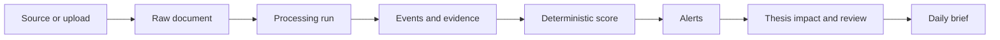
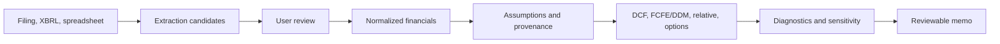
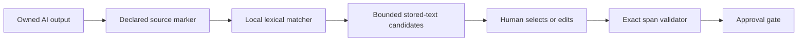
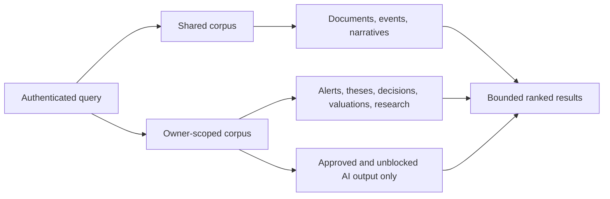
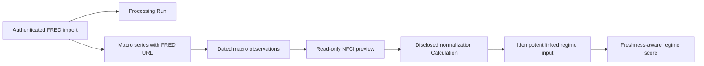

# Workflow implementation reference

Detailed source behavior supporting the [architecture](../architecture.md).
Use the [code map](../code-map.md) for owners and tests and the
[limitation ledger](../limitations.md) for trust boundaries.
Historical validation remains dated in [Current State](../current-state.md).

## Public briefing selection

Manual refresh, ordinary reads and scheduled briefs use deterministic evidence
assembly. The dashboard explicitly loads linked document/source metadata without
source bodies. New public coverage records capture the collection-time window,
eligible/included/excluded counts, caps and reasons for events, failed runs and
derived inspection actions. Dashboard preview and saved-brief selection have
different declared limits. Counts do not certify provider completeness, source
accuracy or interpretation; historical JSON without counts remains unknown and
unchanged. Private reviewed/pending snapshots retain their separate provenance.

## Read-loading and page composition

Company, portfolio, source and processing-run rows do not automatically load
their entire related graph. High-cardinality collections and backreferences use
lazy loading; a workflow explicitly eager-loads relationships it serializes or
uses after closing its session. Company exposure tags remain eager because the
company response includes them. Query-budget tests cover the common read paths.

Portfolio valuation selects the latest eligible price per security with a SQL
window, rather than materializing its whole price history. Historical risk still
loads the bounded series it needs. Provider health selects the latest run per
normalized status/provider and aggregates counts in SQL, retaining the last
success and consecutive-failure count without loading all historical run objects.
No cross-user response cache or stale-data substitution is introduced.

Data Health keeps request handling in its server loader and separates diagnostics,
provider status and processing tables. An explicitly selected audit starts alongside
the six regular reads; fast mode still skips all three optional audits. One pass
over the returned run window builds counters, type summaries and latest-by-source
indexes. Latest attempts use their timestamps, including timezone offsets. Totals
disclose the endpoint's latest-100-run scope. Failed envelopes remain visible and
cannot become healthy zero counts, successful empty lists or cached payloads.

The two portfolio list pages use a shared server-only loader with at most four
valuation requests in flight per page. Management no longer requests analytics
that it never renders. Failure envelopes and input order are retained; this bound
does not establish concurrent-user capacity or cache financial data.

The portfolio detail route first resolves the owned portfolio, then streams only
the selected server view: Overview, Performance & risk, Activity, or Data & setup.
Each view owns its requests and metadata handling. A legacy URL with only period
dates selects Performance; new period forms retain that tab explicitly. The
default Overview does not execute risk, attribution, readiness or setup queries.
Dashboard uses its single consolidated read; company editing mounts only the
selected record's form. Saved valuation refresh resets versioned form inputs
without remounting the workspace's save confirmation.

Risk comparison exposes each latest price date and age. Prices older than five
calendar days make the result partial and withhold the current DCF price gap;
historical risk can still be shown with the stale-price warning. This is not a
guarantee of live pricing or a realized total-return series.

Risk returns align both start and end dates. Missing FX never joins nonadjacent
observations into one return, and stale FX keeps coverage partial. Annualization
assumes 252 observed trading periods; exchange calendars are not verified. Both
portfolio valuation consumers compare the explicit saved cash-flow currency and
require finite output/quality values. Missing currencies and stale current prices
withhold comparison gaps without rewriting historical assumptions or outputs.

Explicit dated portfolio reads and snapshot capture use `portfolio_replay` to
reconstruct recorded positions/cash and reconcile the full ledger to current
declared balances. Purchase-date FX preserves the remaining average cost basis.
Missing opening history and unsupported actions cannot become inferred activity.
Snapshot JSON retains a versioned activity hash and source IDs. Downstream
performance checks that hash against current dated records; corrections make old
results provisional, without rewriting them. Legacy/manual snapshots remain
unverified. Ordinary current-position views still expose declared User Assumptions.

The saved DCF relative-valuation workflow uses read-only
`GET /api/valuation/relative/assumptions/{assumption_id}/inputs` and
`POST /api/valuation/relative/assumptions/{assumption_id}/run`. Both resolve the
assumption through its owned model. The adapter owns the numeric mapping and
input provenance; the browser submits benchmark selection, explicit input-basis
confirmation, and the preview SHA-256, never replacement company financials.
The run rereads the saved inputs and rejects a changed hash before invoking the
existing relative engine. No extra assumption record or DCF run is created.
The direct custom-financial relative route retains its prior contract.

DCF implied pricing is separate from benchmark relative valuation. The pricing
service maps final DCF values and explicit saved denominators. Response schemas
provide the owned assumption context to a detached read-time reconciliation;
contextless reads suppress legacy ratios. The adapter replaces only structured
pricing diagnostics and returns formula/source/timestamp metadata, without
writing historical records or rerunning their DCF or quality score. Scenario
responses receive their transient scenario assumptions, not a different Base set.

Scenario generation dispatches through the owned model's engine and rejects stale
or invalid saved input sets. It remains a non-persisting calculation. The scenario
UI mounts on demand, isolates responses by model/input identity and timestamp,
and uses backend values and gaps instead of browser finance formulas. A shared
saved-output display helper gates currency, identity, diagnostics, stale state,
and finite values for the headline, supplementary, multi-method and scenario
cards. Historical scores are displayed as stored calculations, never synthesized.

## Document to intelligence

Every external action should create a processing run. Imported text and HTML are
untrusted. Exact locators are stored where available; unsupported historical
records must retain explicit fallback states.

## Financials to valuation

The read-only financial review planner joins company-scoped periods, scalar
metrics, reviewed candidates and active source revisions. It never loads binary
document payloads or promotes evidence. Bounded source/candidate links and separate operating,
bank-equity and equity-cash-flow tracks guide the Fundamentals panel; traceability
counts do not certify completeness. The normalization route verifies that the
selected period belongs to the company before any write.

Macro canonical and compatibility routes share backend calculation services and
pure domain contracts. Compatibility calls verify company/model ownership and
do not persist inputs/results. Chronological consecutive observations, nullable
constant-factor slopes, per-factor segment coverage and incomplete scenario totals
cross the API unchanged; the frontend only formats results and validates forms.

Promotion is a trust boundary. Unreviewed candidates and AI suggestions must not
silently become valuation facts.

The separate source-to-draft path reads annual SEC candidates as **Source Summary**
suggestions, never as promoted company facts. A newer annual basis can populate
an owned draft; an existing reviewed annual basis is not mixed with differently
scaled SEC amounts. Sources retain candidate IDs, exact locators, dates, units and
review requirements. `valuation_input_units` converts explicit source units to
full currency amounts and full shares before derived inputs. Ambiguous or
cross-currency amounts remain unavailable; original values and conversion formulas
are retained. Forecast growth remains an Estimate. FRED DGS10 supplies an
explicitly reviewed USD rate proxy, not an INR rate; a mismatched stored quote
cannot silently supply the draft's comparison price. Promotion rechecks source,
benchmark, method and freshness signatures and applies model-specific review gates.

`valuation_source_refresh` owns a durable ProcessingRun queue. HTTP enqueues and
returns immediately; the separate worker fetches FRED/SEC/prices, records child
runs, then refreshes owned drafts while preserving edits. Weekday 07:00 New York
execution is opt-in via local settings, once per local day, DST-aware and guarded
by a PostgreSQL advisory lock. Failures remain visible; interrupted jobs need an
explicit retry, and missed dates are not replayed. No external AI, source approval
or saved-model writes occur. Draft mutations lock/reload the persisted row before
their optimistic-version check. An owned queued job can be cancelled under the
same worker lock, retaining its audit record and unlocking draft editing; running
or completed jobs cannot be cancelled. This does not add a general-purpose job platform.

## AI claim to exact evidence

Evaluation v4 separates citation/policy pass status from bounded per-marker
literal review cues. The claim-review service compares numeric tokens, flags
multiple source periods and instruction/inference language, and exposes its
100-marker/100,000-character limit. Approval requires notes for flags or truncation;
it is still a human judgment. Citation changes reset existing approval and retain
its prior review receipt in evaluation metadata. Re-evaluation synchronizes the
blocked state without a provider request or bulk rewrite of historical output.

The Daily Brief research inbox has a separate private-source workflow:
`brief_sources` routes -> intake/extraction service -> owner-scoped source table
-> explicit disclosed AI scan -> structured findings and exact quote validation
-> links to existing valuation-draft controls. No draft values, holdings or thesis
notes are transmitted. Provider/model/input hash, source/page spans, failures and
review state remain inspectable. Invalid output is blocked, never replaced with
Mock Data. The source list excludes full text/PDF bytes; detail and binary routes
require ownership and use private/no-store responses. Normal reads do not scan.
The proxy permits 45 seconds only for explicit source scans; ordinary requests
retain their short timeout. Source parsing, AI orchestration and presentation
have separate owners. `brief_private_context` saves bounded owner-scoped evidence
in manual and scheduled deterministic briefs: ten companies, twenty distinct source
contents and thirty decisions, with exclusions and input hashes. Reviewed analyst
context requires current receipts and approved interpretations; other eligible
findings remain in a separate review queue. Saved context is immutable as generated,
including after later source lifecycle changes. This path never invokes external AI.

Private-source search filters stored title/text, company, format, scan state and
active/archived state before a bounded ID cursor page. Collections default to
active sources. Owner-only detail and PDF links still resolve archived evidence.
The lifecycle service owns version-checked archive/restore writes independently
of source content and AI review. Live scans block organization changes; expired
scans may be abandoned after two minutes. Scan publication/failure compares the
claimed start timestamp and lifecycle version, so late attempts cannot overwrite
a newer success or revive an archived/restored record. Failed provider attempts
remain in AI execution records, without guessing the latest output's identity.

`brief_source_triage` is a separate read-only comparison service. An authenticated
company-scoped GET examines at most the newest 50 active private sources, with
three bounded evidence queries, plus one latest-review query, and no original-body loads. It reconstructs constrained
findings from the linked output and exact-span receipts, excluding failed,
blocked, rejected, revision-required or mismatched output. Groups reference the
shared source findings instead of duplicating evidence for every field. Draft
links are rebuilt from the field catalog, not trusted from stored AI/UI strings.
Opposing increase/decrease suggestions across distinct content are review flags,
not verified contradictions. V2 uses literal quote labels for period, currency and
economic scope, exposing same/unknown/incompatible bases without inferring missing
labels. V1 analyst receipts remain readable but stale against V2. Exact text hashes prevent copied records from
becoming cross-content corroboration; Mock Data is opt-in and never compared
against non-mock evidence. Counts, exclusions, source dates, provenance and the
50-source window remain visible. The frontend owns filters/display only, clears
responses on scope changes or failures, and offers separate source/draft links.
This read model has no provider, approval, resolution or valuation-write path.
Following a draft link enters the existing draft workflow, which can initialize
a review-required draft if absent. No comparison suggestion is applied there.

`brief_comparison_reviews` owns the separate append-only analyst-decision workflow.
It recomputes a canonical company comparison hash, checks the displayed evidence
and expected scoped review version, then stores the selected group's evidence
and rationale. A user-row lock and unique scoped version prevent competing review
writes from silently replacing each other. History/detail are owner-scoped and
report whether the stored evidence basis still matches. They do not approve AI,
resolve semantic conflicts or update financial values. Changed sources can make
a receipt historical immediately after saving; receipts are not permanent truth.

Security boundary helpers have separate owners: frontend `request-security.ts`
checks trusted host/same-origin mutations, forwards only allowed headers and
bounds bodies; `local-login.ts` throttles attempts and compares hashed credentials.

PDF services delegate resource-heavy parsing, geometry and rendering to
`pdf_jobs.py` and a single-use `workers/pdf_parse_worker.py`. Linux child limits
bound CPU, memory and output; the parent bounds wall time and concurrency, strips
credentials, validates results and reaps failed children. This is resource isolation,
not a malware sandbox. `providers/safe_http.py` owns shared bounded HTTP responses
and DNS-pinned public downloads; fixed-host FRED/Gemini have explicit transport limits.
Backend `request_limits.py` bounds bodies before parsing; `rate_limits.py` applies
per-path defaults without relying on lazy router traversal. Public-source downloads
use `providers/safe_http.py` for validated pinned DNS, TLS and byte limits.
`sec_xbrl_ingestion.py` owns audited candidate-only intake for current and legacy
SEC routes. The legacy URL preserves its envelope but cannot write unreviewed
financial metrics. CSV readers reject ambiguous column shapes and values outside
stored decimal precision; import failures omit raw exceptions/database parameters.
Normal backend/workers are non-root; web/workers drop capabilities, prevent
privilege escalation and bound processes/memory. These are local hardening,
not a public-deployment authorization or comprehensive sandbox.

Company/portfolio research cards use one bounded SQL query over selected company
identities and latest stored annual Item 1 excerpts. Full document graphs are not
loaded. Missing business text stays unavailable. Comps navigation exposes the
existing owner-scoped peer workspace; it does not create a second calculation or
an unsupported automatic peer-data feed.

The matcher is deterministic and local. It returns exact quotes and offsets,
not trusted citations. It never calls an external model, never mutates the AI
output, and cannot bypass validation or human review. Unsupported source types,
missing stored text, undeclared markers, and low-overlap candidates remain
explicit states.

## Unified stored-research search

`backend/app/services/evidence_search.py` owns search and ranking. PostgreSQL
uses full-text search; SQLite tests use bounded `ILIKE` matching. Narrative
records retain their existing shared scope and are labeled as interpretations.
Research sessions, user messages, and AI output are private and filtered through
the authenticated user. Assistant message bodies are not independently indexed;
their linked output becomes searchable only after the existing human-review and
blocking gates pass. Company filters exclude private research sessions because
those records have no company relationship rather than guessing one.

## FRED observation to Market Regime input

Import owns external network access and audit persistence. Preview and apply use
stored records only. The apply action never fetches FRED, and each automated
input retains the exact `macro_observation` record ID. Manual provider
declarations without a stored record remain Source Summaries.

## Damodaran data lifecycle

Runtime workbooks are mirrored under `data/damodaran/raw`. Implemented importers
validate exact contracts, hash source bytes, preserve changed versions, reactivate
known hashes, link typed rows to a dataset version, and expose only the active
version. Generic parsing is inventory, not application support.

The separate knowledge base preserves raw doctrine and source extraction under
its own `AGENTS.md` and audit process.
